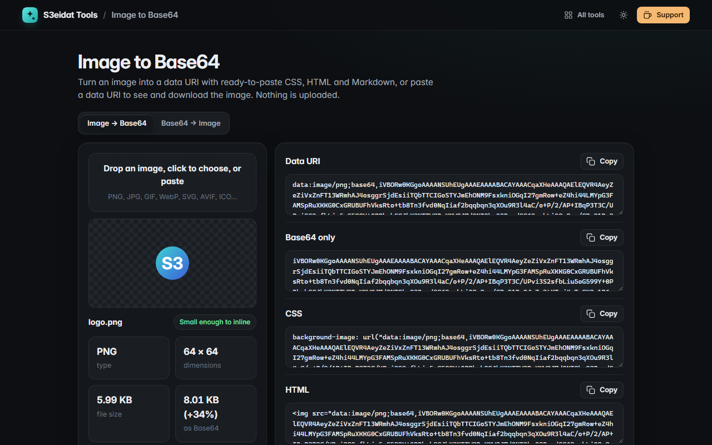

# Image to Base64

> Turn images into data URIs and back. Free, private, and it runs entirely in your browser.

### ▶ [Open Image to Base64](https://s3eidat.github.io/image-to-base64/)



## Features

**Image → Base64**
- Drop, choose or paste any image (PNG, JPG, GIF, WebP, SVG, AVIF, ICO…)
- Ready to copy: **data URI**, **raw Base64**, **CSS** `background-image`, **HTML** `` (with width/height) and **Markdown**
- For SVG, a **URL-encoded data URI** too, usually much smaller than Base64
- Shows type, dimensions, file size and the Base64 overhead, with a **size warning** when an image is too big to inline sensibly
- Save the data URI as a `.txt` file

**Base64 → Image**
- Paste a data URI, a CSS `url(…)`, an `` tag or **just the Base64** (URL-safe Base64 and line breaks are fine)
- Detects the real file type from its bytes, previews it, shows dimensions, and **downloads** it with the right extension
- Clear errors for invalid Base64, and a note when the declared type doesn't match the bytes

## Privacy

Your images never leave your device: encoding and decoding happen in this page with the browser's own
`btoa`/`atob`. There is no server, no account, no analytics. The page ships with a strict Content-Security-Policy
(`connect-src 'self'`), so the browser itself blocks any attempt to send data anywhere.

## Run it yourself

It's plain HTML, CSS and JavaScript with no build step:

```bash
git clone https://github.com/s3eidat/image-to-base64
cd image-to-base64
python -m http.server 8000
```

Then open http://localhost:8000.

## Support

If this saved you time, **[buy me a coffee ☕](https://s3eidat.github.io/coffee/)**. It keeps every tool free.

---

Part of **[S3eidat Tools](https://s3eidat.github.io/)**: 100+ free, private tools that run in your browser. MIT licensed.
